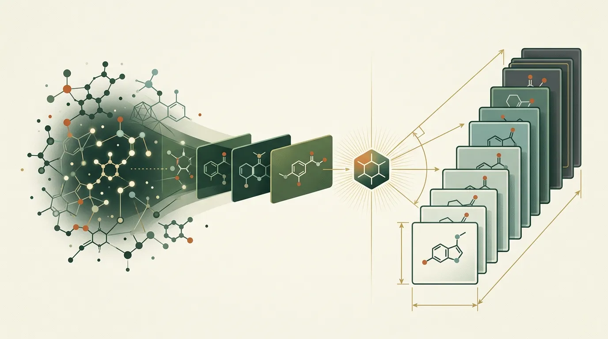

**Exact kNN similarity ranking returns the k most similar rows, [the same rows a brute-force scan](https://mossflux.com/docs/) returns, ordered by exact score. It does not have to score every row: [BitBound pruning](https://mossflux.com/docs/design) skips rows only on a proven bound.**

You have a query molecule and a compound library, ChEMBL or an in-house collection, and you need its top k neighbours. A neighbour left out of the list gives no warning, so you need to know none was missed.

You'll be able to define exact kNN similarity ranking in terms a test can check, predict the order of a result list, size the memory for an index, and choose between exact and approximate search for your library.

> **Key Takeaways**
> - Ties break by [lower popcount, then the earlier row](https://mossflux.com/docs/design), so a query returns the same list every run.
> - The index lives in memory at [about 2.5 KB of RAM per molecule](https://mossflux.com/docs/deploy). ChEMBL 37 (2,896,304 molecules) takes 5.1 GB.
> - Use exact results as the ground truth when you judge an approximate method's recall.

## What is exact kNN similarity ranking?

Exact kNN similarity ranking is a nearest-neighbour search whose top k can be checked row for row against a scan that scores every row. It has no false negatives, so no true neighbour is missing, and no false positives, so no row sits in the list that a full scan would rank lower.



[Elastic's kNN search guide](https://www.elastic.co/guide/en/elasticsearch/reference/8.19/knn-search.html) defines the task: "A k-nearest neighbor (kNN) search finds the k nearest vectors to a query vector, as measured by a similarity metric." For a chemical library, the vectors are binary fingerprints and the metric is Tanimoto.

[OpenSearch's exact k-NN page](https://docs.opensearch.org/latest/vector-search/vector-search-techniques/knn-score-script/) describes its exact option as a scoring script that "executes a brute force search", and it says this doesn't scale as efficiently as the approximate approach. An approximate method visits only a subset of candidates, so a true neighbour outside that subset is never scored and never reported.

With k = 10, exact kNN similarity ranking returns the 10 rows that scoring every row and sorting would give. An approximate search can return a list that differs by one row, with no warning.

mossflux's docs state that [every answer is exactly what a brute-force scan returns](https://mossflux.com/docs/). Its [correctness page](https://mossflux.com/docs/correctness) covers what "exact" means and the tests behind it.

Threshold search isn't the same query as kNN:

- kNN returns the k nearest rows, however low their scores are.
- Threshold search returns every row with Tanimoto >= t, so the number of hits depends on the data and can be zero.

## How does exact kNN similarity ranking order results and break ties?

Exact kNN ranks rows by their exact Tanimoto score, highest first, and breaks equal scores with a fixed rule, so the same query always returns the same list.

For binary fingerprints the Tanimoto coefficient is c / (a + b - c). Here a and b are the set-bit counts of the two fingerprints, and c is the number of bits set in both. The score runs from 0 (no shared bits) to 1 (identical bits).

mossflux keeps each score as an exact fraction and ranks by it. No pair of rows is left undecided, so no run can order them differently.

### Worked example with toy bits

These 8-bit strings are toys, not the fingerprint of any molecule. Take the query bits `11110000`, so a = 4.

- Row 1, `11000000`: b = 2, c = 2, score 2 / (4 + 2 - 2) = 2/4.
- Row 2, `11101100`: b = 5, c = 3, score 3 / (4 + 5 - 3) = 3/6.
- Row 3, `11110011`: b = 6, c = 4, score 4 / (4 + 6 - 4) = 4/6.

Row 3 ranks first, at about 0.667. Rows 1 and 2 are different fractions with the same value, 1/2.

Row 1 has popcount 2 and row 2 has popcount 5, so row 1 comes second. The order is rows 3, 1, 2. If two tied rows had the same popcount, the earlier row would come first.

Hamming distance counts differing bits instead. Against the same query, row 1 differs in 2 bits, row 2 in 3 and row 3 in 2. Rows 1 and 3 tie under Hamming, while Tanimoto puts row 3 clearly ahead, so a Hamming-space kNN isn't a Tanimoto kNN.

A top score needs one more check. Salts, tautomers and stereo must be canonicalised before ingestion.

## How does exact kNN similarity ranking avoid scanning every molecule?

Exact kNN similarity ranking avoids scanning every molecule by pruning: it skips any row whose best possible score is already too low, and the popcounts alone prove that.

For binary fingerprints, the popcount (the number of set bits) of the query and of a candidate is enough to cap the Tanimoto score, with no comparison of the bits themselves.

The arithmetic is short. Tanimoto is c / (a + b - c), where a and b are the two popcounts and c is the number of shared bits. Shared bits can't exceed the smaller popcount, so the score can't exceed min(a, b) / max(a, b).

Say the query has 40 set bits and the cut-off is 0.8. A candidate with fewer than 32 set bits or more than 50 can't reach 0.8, so its score is never computed.

The search stays exact because a candidate is rejected only when its best possible score falls below the cut-off. Any row that could still qualify stays in play and gets its true score.

An inverted bitmap index returns the same rows as the linear scan, byte for byte.

## Exact or approximate kNN: which do you need?

You need exact kNN when a missed neighbour is a defect or when you need a ground-truth list; approximate kNN fits when you can accept lower recall and have measured it.

| Property | Exact kNN | Approximate kNN |
| --- | --- | --- |
| Candidates visited | Every row, or rows a proven bound keeps | A shortlist |
| True neighbours missed | None | Possible |
| Role as ground truth | Reference list | List being scored |

A third reason to choose exact is a collection that fits in memory at a cost you have measured. A compound library where every true hit matters usually meets all three tests.

The ground-truth role holds whatever your data. Run the same queries through an exhaustive search and through the approximate method, then count how many of each exact top k the approximate method returned. That count is its recall, and only a search with no gaps can supply the reference list.

Filtering changes what "k" means. [OpenSearch's scoring script documentation](https://docs.opensearch.org/latest/vector-search/vector-search-techniques/knn-score-script/) says "you can apply a filter on an index before executing the nearest neighbor search." When the filter runs first, ranking happens inside the restricted set, so a query for k = 10 returns 10 rows if 10 rows pass the filter.

A post-filter reverses the order. An approximate search returns a fixed shortlist of k rows, and the filter then removes rows from that list. If it removes 4, you get 6, and better matches that were never on the shortlist can't replace them.

The cost of the exact route is stated plainly in the same OpenSearch page: the scoring script "executes a brute force search", so it "doesn't scale as efficiently as the approximate approach." Measure that on your own collection before you rule it out.

mossflux has no approximate mode, so there's no recall setting to tune. The candidate set is that whole database, and the top k is ranked from it.

## What does exact kNN similarity ranking cost in time and memory?

A full kNN scan does work proportional to the number of rows, so time and memory both grow linearly: ten times the molecules means about ten times the work and ten times the RAM.

| Figure | Value | Conditions |
| --- | --- | --- |
| Index build time | 33 to 41 s | ChEMBL 37, 2,896,304 molecules |
| Index size | 5.1 GB | ChEMBL 37, in memory |
| RAM per molecule | About 2.5 KB | Sizing rule |
| Similarity time vs FPSim2 | 2.64x to 2.77x faster | EPYC 9645 VM, 256-bit Morgan r=2, 1 thread vs 1 worker, median of 11 |

Memory comes first, because mossflux builds its index in memory at start and doesn't save it to disk. The [deploy page](https://mossflux.com/docs/deploy) gives ChEMBL 37 (2,896,304 molecules) a build time of 33 to 41 s and an index of 5.1 GB, about 2.5 KB of RAM per molecule.

At that rate:

- One million molecules need about 2.5 GB.
- Ten million molecules need about 25 GB.

Time for exact kNN similarity ranking follows the same line. The BitBound prune skips rows whose best possible score is already too low, and hardware popcount makes each remaining comparison cheaper; neither changes the answer.

The [benchmarks page](https://mossflux.com/docs/benchmarks) reports similarity search against FPSim2 at 256 bits as 2.64x to 2.77x faster. The run used an AMD EPYC 9645 VM, 256-bit Morgan r=2, ChEMBL 37 (2.9 million molecules), 1 mossflux thread against 1 FPSim2 worker, search only, median of 11.

No aggregate win over Arthor's 96-thread figure is claimed, and no billion-scale substructure rate. Aggregates across different machines aren't comparable.

The timings were taken before the 2026-10-03 hardening pass and were not re-measured on the new code. The exactness gates pass on it.

On the [API limits](https://mossflux.com/docs/api), each request is limited to 10,000 hits, and 4 searches run at once by default, with more waiting. A limit refuses a request and never changes an answer.

## How do you run exact kNN similarity search through an API?

You run exact kNN similarity search through an API by starting `mossflux serve` over a SMILES file and posting one SMILES to `POST /v1/similarity`. The server computes its own [2048-bit ECFP4-style fingerprints](https://mossflux.com/docs/api), so you never send a fingerprint.

1. Install and start the server. Then name a database with `--db NAME=PATH`:

   ```sh
   mossflux serve --db chembl=chembl_37.smi
   ```

2. Wait for readiness. `GET /ready` returns 503 until every database is loaded. Send your first query only after it returns 200.

3. Post the query. The API page lists the `POST /v1/similarity` fields: `smiles`, `threshold`, `k`, `limit` and `db`. This request asks for the 10 nearest neighbours of pyridine, `c1ccncc1`:

   ```json
   {
     "smiles": "c1ccncc1",
     "k": 10,
     "db": "chembl"
   }
   ```

 Set `db` to a name you passed to `--db`. The response fields are documented on the same API page.

4. Call the same search over MCP. The tool is `similarity_search`. Reach it at `/mcp` on the server, or over stdio with `mossflux mcp`.

All three run on one engine, so they can't disagree about a result.

For an FPS file on disk, `mossflux search` runs the same kind of search from the shell. Its counts are always exact, and `--limit` caps only the printed hits. The [CLI reference](https://mossflux.com/docs/cli) lists the flags.

To see it on your own compounds, [run mossflux on your library](https://mossflux.com/#get) with your SMILES file as the database.

## Frequently asked questions

### What is the difference between exact and approximate kNN?

Exact kNN compares the query with every candidate, or prunes only on a proven bound, so it returns the same rows as a brute-force scan. Approximate kNN visits a subset of candidates and can miss true neighbours. Pick exact when a missed neighbour is costly, and to judge an approximate method's recall.

### Does exact kNN have to scan every row?

Exact kNN skips rows only when [BitBound pruning](https://mossflux.com/docs/design) proves they can't reach the top k. The bound is rational and rounded down, so a rounding error can never drop a true hit. The result matches a full scan.

### How are ties ordered in a kNN result?

Rows with equal scores are ordered by lower popcount first, then by the earlier row. The rule is fixed, so the same query returns the same k rows in the same order on every run.

### Why does a filtered kNN search sometimes return fewer than k results?

A filter applied after the top k are chosen can only remove rows, so fewer than k may survive. Applying it before the search, as [OpenSearch's exact scoring script](https://docs.opensearch.org/latest/vector-search/vector-search-techniques/knn-score-script/) allows, ranks only eligible rows.

### Does a score of 1.0 mean the same molecule?

A score of 1.0 means the two fingerprints have equal bits, not that the compounds are the same.

## How do you start with exact kNN on your own library?

Start with a memory estimate, then a local server, then a recall check if you also run an approximate index.

Today, check the ordering rules against how you read ranked lists. Then multiply your molecule count by [about 2.5 KB of RAM per molecule](https://mossflux.com/docs/deploy) and compare the result with your machine.

This week, install from source or run the Docker image. Load a SMILES file with `mossflux serve --db NAME=PATH`, then [send a `POST /v1/similarity` call](https://mossflux.com/docs/api) with your query as `smiles`, plus `k` and `db`.

Next, canonicalise salts, tautomers and stereo in your SMILES file before ingestion. If you run an approximate index, use the exact lists as ground truth for its recall.

mossflux is free and open source under MIT OR Apache-2.0, with no paid plan, hosted service or account. [Run it on your library](https://mossflux.com/#get) and send your first query.

## Sources

[mossflux docs](https://mossflux.com/docs/) · [Design · mossflux docs](https://mossflux.com/docs/design) · [Deploy · mossflux docs](https://mossflux.com/docs/deploy) · [k-nearest neighbor (kNN) search - Elastic](https://www.elastic.co/guide/en/elasticsearch/reference/8.19/knn-search.html) · [Exact k-NN search with a scoring script…](https://docs.opensearch.org/latest/vector-search/vector-search-techniques/knn-score-script/) · [Benchmarks · mossflux docs](https://mossflux.com/docs/benchmarks) · [API · mossflux docs](https://mossflux.com/docs/api) · [CLI · mossflux docs](https://mossflux.com/docs/cli). Every other source is linked where the article cites it.
